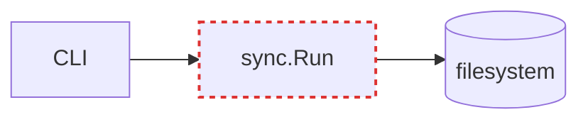
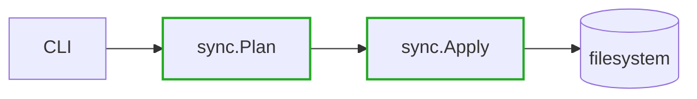

# Architecture Evidence

Draw a before and an after Mermaid diagram (`flowchart` for structure and dependencies, `sequenceDiagram` for runtime interaction) with the same node ids and layout direction, so the two read as a pair. Keep only the components the change touches and their direct neighbours. Mark changes with classes.

````markdown
**Before**



**After**


````

After writing the description, render each block and inspect the images:

```bash
<skill-dir>/scripts/evidence -C <repo> mermaid <file>
```
